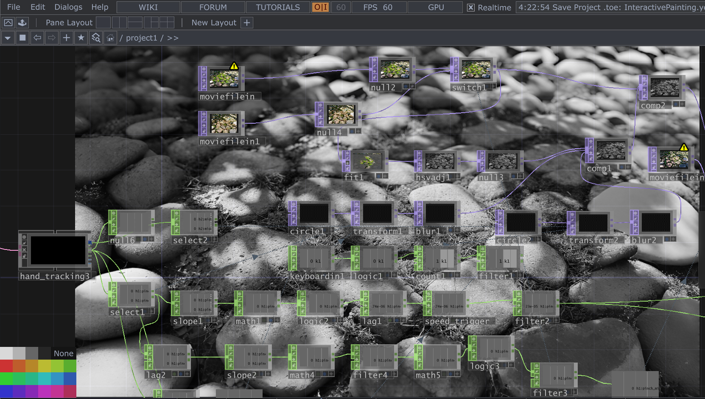
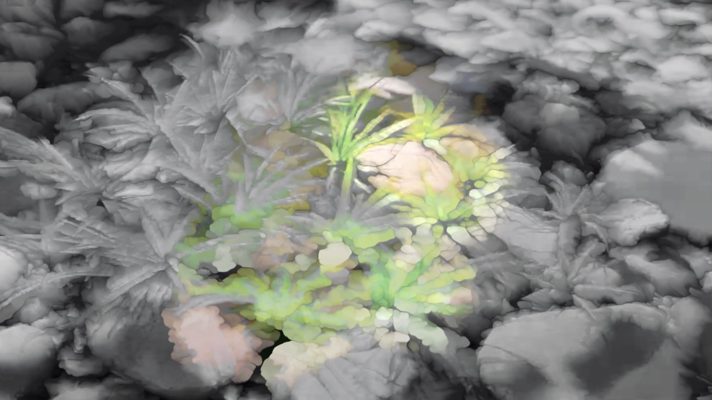
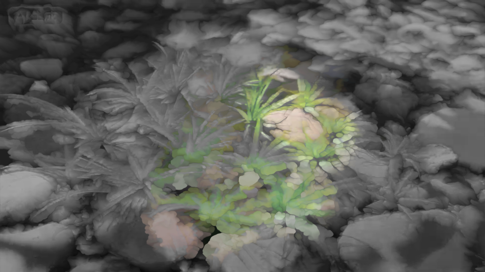
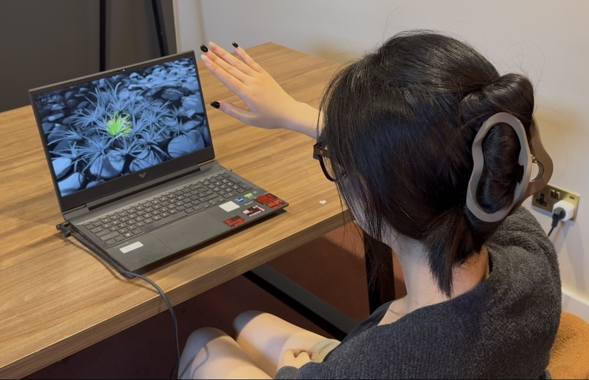
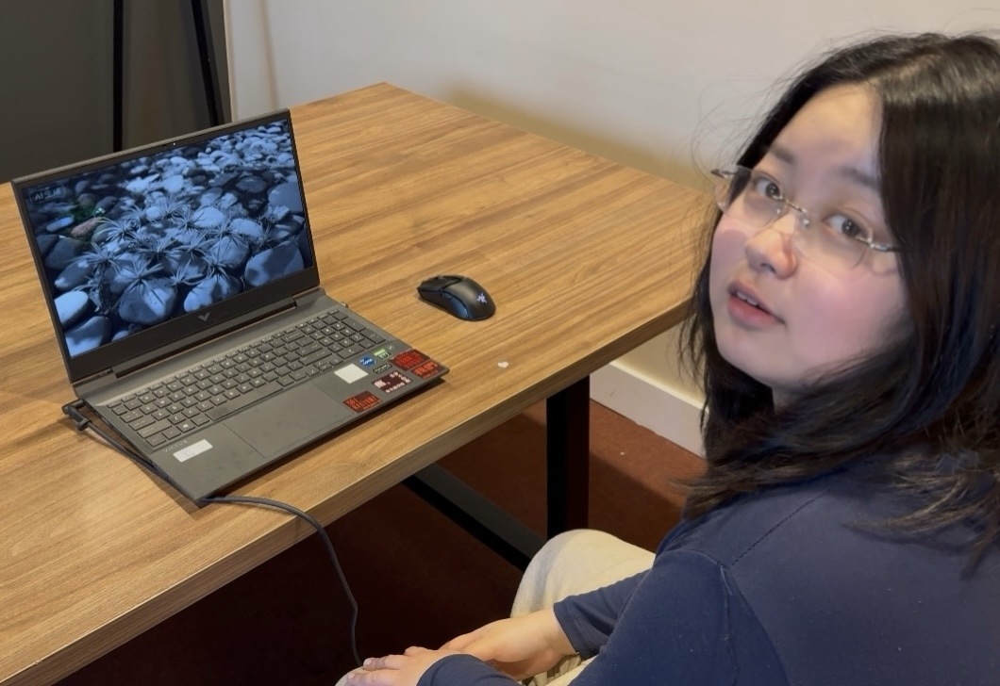
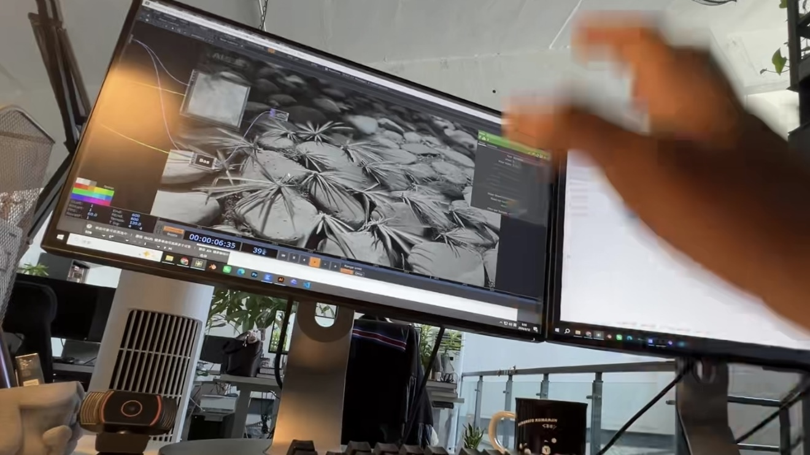
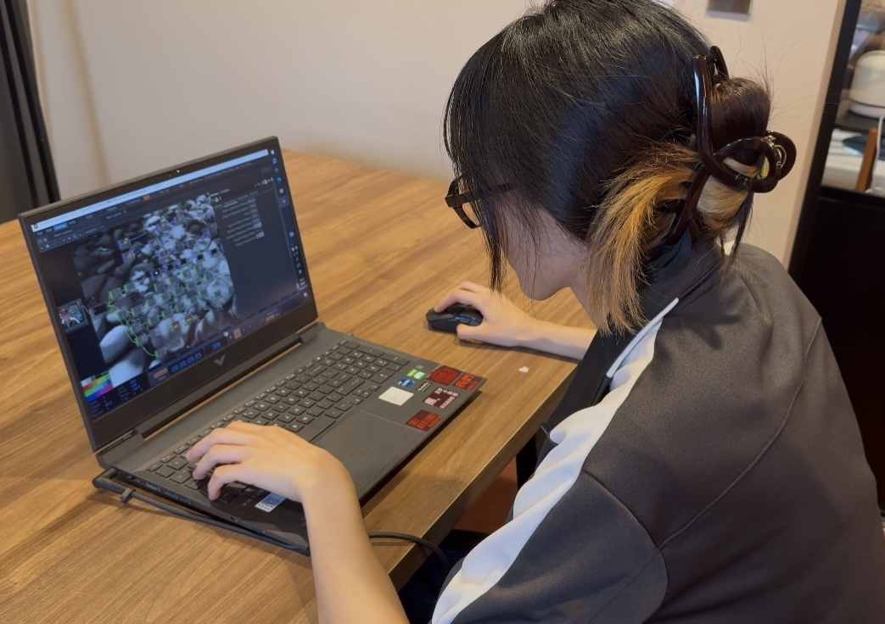
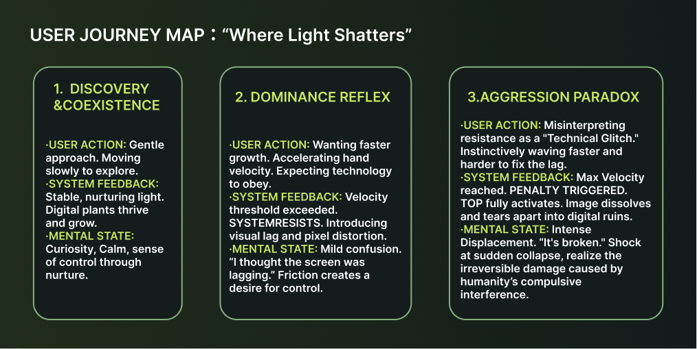

## Final Research Project   

# Where Light Shatters  

## How do users respond to visual friction and ecological resistance in interactive ecosystems, and what can this reveal about human attitudes toward dominating nature?

## Project Description

*Where Light Shatters* is an interactive installation that explores the relationship between humans and digital nature. Departing from Christa Sommerer and Laurent Mignonneau’s 1992 piece *Interactive Plant Growing* — where plants flourish at the slightest human touch — this work prevents users from easily controlling its virtual ecosystem. It rejects the idea of humans as all-powerful masters of their surroundings, and investigates how digital natives react to a system that will not follow orders unconditionally. Drawing inspiration from Ian Cheng’s *BOB*, the installation possesses autonomous behaviour.  

Developed with TouchDesigner, the work uses a webcam and MediaPipe to track hand movement velocity. Slow, gentle gestures nurture healthy growth of the digital plants. Impatient, rapid movements, however, trigger the system’s resistance and create strong visual friction: the visuals distort, and the plants break down into digital ruins.  

As a practice-based research project, it tests human behaviour when dominance over a system is no longer possible. Testing shows that faced with the system’s resistance, users tended to increase their physical force, believing the device was lagging or broken. By constraining human control, the work encourages audiences to reflect on our tendency to dominate nature and our reliance on instant digital feedback.  

## Technical Description
This project utilised TouchDesigner for real-time visual processing and MediaPipe for webcam-based hand tracking.  
To evaluate the quality of the user's movement rather than just their presence, I designed a custom signal processing pipeline. The system extracts the X and Y coordinates of the user's hand (h1:tx, h1:ty) and feeds them into a Slope CHOP, which calculates the absolute velocity of the gestures. This data is combined via a Math CHOP and evaluated by a Logic CHOP.  

When the user's hand velocity exceeds a set threshold, a Lag CHOP is triggered. The Lag CHOP is configured to react slowly and recover very slowly, simulating the nature lagging effect and the long-term trauma inflicted on an ecosystem.  

This velocity trigger dictates the visual output. A low velocity maintains a healthy, growing plant video. When the high-velocity punishment is triggered, a Switch TOP will change the visual, a Displace TOP and a Noise TOP will tear the pixels apart, creating a highly responsive form of digital structural dissolution.  


## Individual Contribution Statement
This project is a massive departure from my Sprint 2 group project. Originally, the group project focused on basic TouchDesigner systems that simply counted the number of hands present in the frame to trigger basic visuals.

I independently overhauled both the interaction logic and the conceptual framework. I shifted the entire system from tracking presence to analysing movement velocity and quality. I personally built the custom CHOP pipeline utilising the Slope-Math-Logic sequence to extract velocity, introduced the Lag CHOP to simulate ecological trauma, and used the Displace TOP logic to create the digital ecosystem dissolution that defines the final concept. 

## Project Images 

<sub>Screenshot of the whole system.</sub>


<sub>Detail of the healthy visual state, rewarded by low-velocity movement.</sub>


<sub>Detail of the image apart as a penalty for high-velocity intervention.</sub>


<sub>Image of user testing the interface with slow, gentle gestures to nurture the ecosystem.</sub>


<sub>Image of a user confusing with this system</sub>


<sub>Image of a user testing the system, waving rapidly and triggering the velocity threshold.(Face not shown, per participant request)</sub>  


<sub>Image of me when debugging the system.</sub>

## Link to project files
All necessary project files and assets are included in this repository.  
[Link to the files](/)

* Main File: ```MidiVST-Output-v4.toe``` (Main TouchDesigner File)
* ```/assets/``` (includes all the necessary video and image files)
* ```/toxes/``` (MediaPipe components needed for the project)

### Instructions for running
* Open MainTD.toe in TouchDesigner.  
* Please make sure your webcam is enabled and connected, not being used by other applications.  
* Sit in front of the camera: move slowly to see growth, and wave rapidly to trigger the displacement penalty.  

## Demo Video


../assets/27e3d064-eafd-4d76-b94a-4745279ad225.mp4


## User Testing  

### Testing Plan:
| Field | Details |
| ------------------------------ | ----------------------------------------------------------------------------------------------------------------------------------- |
| Who are the testing subjects?  | <ul><li>A CCI student, female, 22 (User A)</li><li>A CCI student, female, 23 (User B)</li><li>An animator, male, 27 (User C)</li><ul>  |
| What are we observing?         | Observing spontaneous physical reactions (hand velocity, facial expressions) when the system resists their control. No prior instructions provided. |
| How recorded?                  | Written notes for observations and Audio recording. |

#### Questions for the interviews:
* “When the plants stopped growing and the image distorted, what was your immediate thought?”  
* “How did your physical movement change when you realized the system wasn't doing what you wanted?”  
* “Did you feel like you were breaking the environment, or did you feel like the software was broken?”  

### Testing Observations:

| Tester | What I Observed | What Surprised Me | 
| --------- | ---------------------------------- | -------------------------------------------- |
| 1. User A | Touched the air very gently from the start. Maintained a healthy ecosystem throughout. | She naturally respected this digtal system. 
| 2. User B | Started fast, noticed the visual decay, and verbally expressed confusion. Eventually slowed down. | It took nearly 2 minutes of trial and error for her to realize gentleness was the solution.
| 3. User C | Waved hands rapidly. When plants dissolved, he immediately waved faster and harder. | He instinctually escalated force to "fix" a lag, completely ignoring the visual cues of destruction.  

I was highly surprised by how deeply ingrained the Dominance Reflex is in users. Two of the testers (especially those accustomed to high-feedback digital environments) did not interpret the visual decay as a consequence of their actions. Instead, they treated it as an obstacle to be overcome with more physical force.  

### Interview Responses:

#### User B:
Noticed the shift, but took a long time to connect it to her gesture speed.
"At first, I was really confused why it was glitching out. Once I realised that moving slower actually fixed it, it felt like the computer was training me."  
#### User C: 
Expressed intense frustration during the interaction. He felt the system lacked responsiveness, which prompted him to try and force the interaction. He said "I thought the camera was lagging, so I tried to force it to read my hand by waving harder. I didn't realize I was killing the plants, I just thought your code was buggy." 

#### Key responses:

> "I think my body felt more relaxed and I'm more in control. I didn't have to think so much about physicality of doing it."

> "The first one you've got that's more of a visual as more of a visual representation that you can kind of follow. It seemed to like be mapped out visually better, but with the other one, we felt more tactile in a way and you could just explore."
> 
### Actual User Journey Map:


### Revision Plan:

| Question | Your Response |
| --------------------------------------------------- | ---------------------------------------------------------------------- |
| What worked well, and why? | The Displace TOP with the Lag CHOP effectively communicated environmental destruction and trauma. The visual friction was visceral. |
| What did not work as expected? | Users misinterpreting intentional ecological resistance as a "technical glitch" (camera lag). |
| What did we learn about the research question from testing?	| Human nature in digital spaces tends to be greedy. We cannot rely on users to naturally find a "sweet spot" of coexistence; the system must actively force them to confront their aggression.| 

From the table above and subsequent feedback from my Pecha Kucha presentation, I would do these to improve this project:  
*Build An Ecological Dormancy mechanism: If plants dies as a result of violent human actions, the system will go lock. This forces the user to wait in silence, experiencing the irreversible consequences. If a user consistently exceeds the velocity threshold, the system shouldn't just distort—it should crash entirely. The screen will go black for a mandatory 60 seconds.  
*Adjust project presentation: By locking them out, the installation forces them to stand in silence, transforming frustration into a period of reflection. I wanna "show them" the consequences, rather than waiting for them to figure it out.  
* Add Sonic Feedback: Incorporate the sound of digital static or cracking dry leaves during the Dissolution effect. Using multi-sensory feedback to help users get a better understanding of the meaning of the project.


## Conclusion
This project asked a core research question: How do users respond to visual friction and ecological resistance in interactive ecosystems, and what can this reveal about human attitudes toward dominating nature?  

From the user testing, I found a very clear pattern. People today are very used to technology doing exactly what they want, immediately. When my digital ecosystem showed resistance (when the plants stopped growing and the screen distorted), users did not slow down to think. Instead, they waved their hands faster and harder. Most of them thought the camera was lagging or the system was broken.  

This reaction shows that we have a strong habit of wanting to control and dominate the technology and the environment. If something in nature or in a computer system does not obey us immediately, our first reaction is to use more physical force to make it work.   

I want to prove that interaction design does not always need to be smooth, easy, and pleasing. By adding visual friction and making the system uncooperative, we can break the user's illusion of control. This kind of design can be a powerful tool to make people stop, feel frustrated, and finally reflect on how they treat the natural world.  

## Reflecting
Working on Where Light Shatters has reshaped my understanding of interactive art and human-nature relations. I started with a human-centred design that allowed full user control, but later redesigned the system to feature autonomous behaviour, ecological resistance and visual friction, breaking away from the conventional instant-response interactive mode.  

User tests delivered striking findings: digital natives tended to apply greater force when the system refused to obey, confusing intentional resistance with technical glitches. This reveals how deeply we crave dominance and immediate feedback in daily digital interactions.  

Technically, I mastered tracking hand movement velocity and building dynamic ecological visuals in TouchDesigner. Creatively, I realised that interaction design can use frustration and resistance as effective tools for ethical reflection. This project has taught me that good interactive work does not merely entertain, but also challenges audiences to reflect on their behaviours and mindsets. I intend to continue refining the system with additional feedback mechanisms to strengthen its expressive power.  

## References:

Cheng, I. (2018/2019) BOB (Bag of Beliefs). https://youtu.be/XFmMrcW2ZsM?si=kPJLzF28BiFeGURY  

Sommerer, C. and Mignonneau, L. (1992) Interactive Plant Growing. [[Interactive installation].](https://youtu.be/JXX7JNFD2X8?si=cmYmojoYIXT4Npd6)  

## LLM Use Disclaimer
1. I used AI generation tools to create the videos of the plant growing. Here is the link:https://gemini.google.com/share/5ebe5bdad2e5
2. I used AI generation tools to create the background music and a image of a dying grass. Here is the Link: https://gemini.google.com/share/85efbcf4f24f
