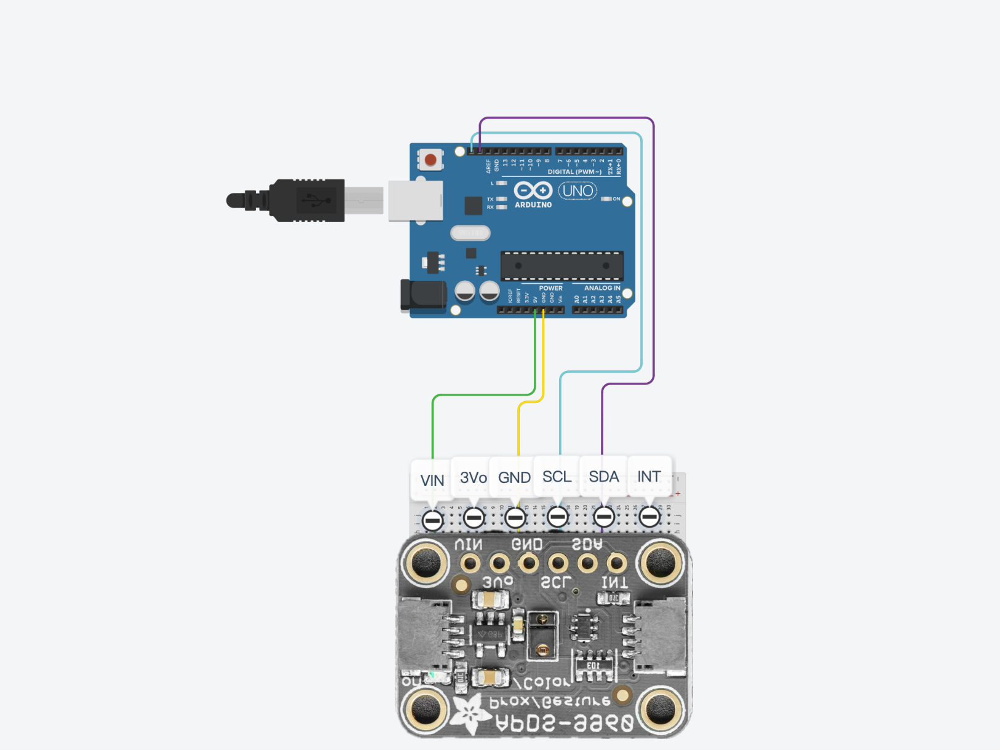
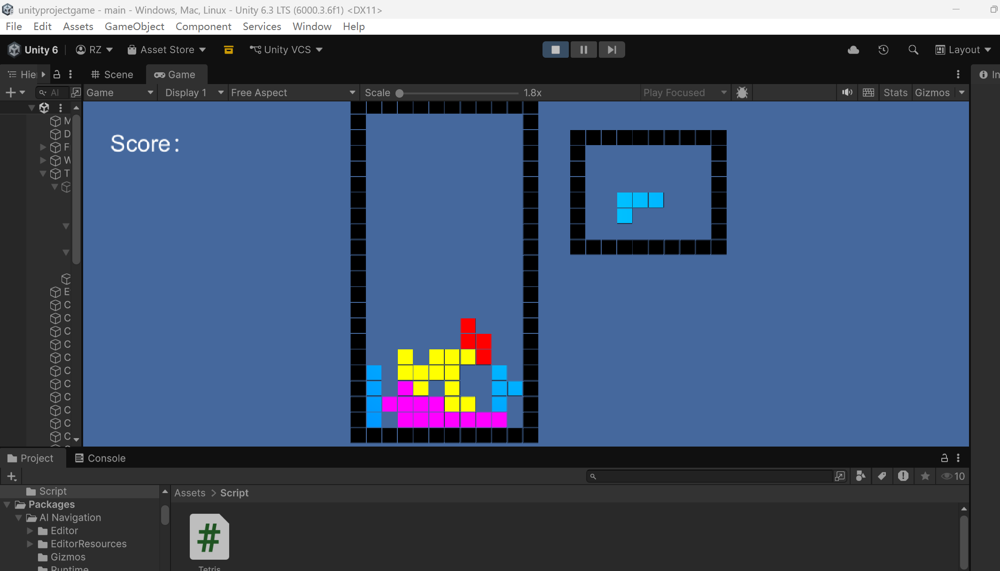
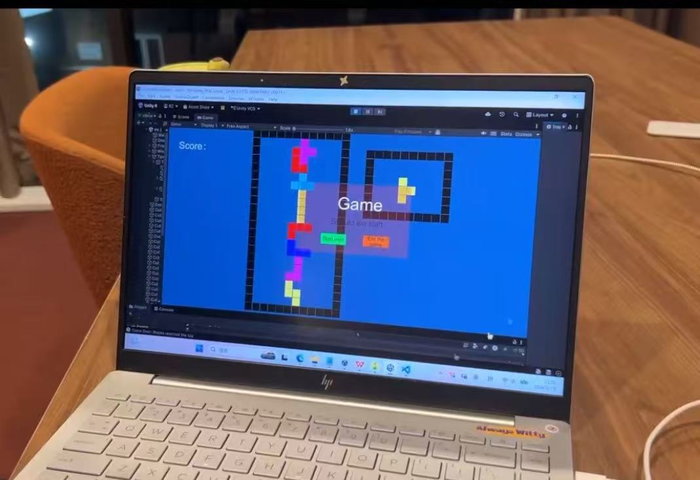

## Week #6 (Sprint 1)

## Sprint 1: Final Delivery 

In Week 6, our primary objectives are to resolve the hardware-software communication bottlenecks carried over from Week 5, complete the final system integration, and optimize the user experience and gameplay feel.  

### 1. Solving the Serial Communication
When interfacing the APDS9960 gesture sensor with the Unity engine, we encountered stubborn communication dropouts. Through systematic debugging, we identified and resolved three distinct technical conflicts:

* **Port Contention (Exclusive Access):** Initially, Unity frequently threw a `TimeoutException`. We discovered that Windows OS enforces "Exclusive Access" for COM ports. Leaving the Arduino IDE's Serial Monitor open caused it to hijack the sensor data, starving Unity of any input. **Solution:** We established a strict testing protocol requiring the complete closure of any background serial monitors before hitting "Play" in Unity.
* **The Native USB Quirk (The DTR Signal Fix):**
  Even after clearing port contention, Unity received no data, despite the Arduino's onboard `TX` LED confirming data transmission. Upon investigating the **Arduino UNO R4 WiFi** architecture, we found it utilizes a native USB interface rather than a traditional serial-to-USB bridge. This native interface requires a `Data Terminal Ready (DTR)` signal from the host computer to authorize data flow. **Solution:** We forced this authorization by adding `serialPort.DtrEnable = true;` to our C# initialization script, successfully unlocking the data stream.
* **Buffer Congestion & Clean Parsing:**
  Previously, the Arduino transmitted debugging text (e.g., `"Current proximity: 150"`) alongside directional commands (`"L"`/`"R"`). Unity's strict line-by-line reading (`ReadLine`) caused commands to be overwritten by redundant debug info, leading to severe latency. **Solution:** First, we stripped all debugging text from the Arduino firmware, turning it into a silent messenger that only outputs `"L"` or `"R"`. Second, we upgraded the Unity script to use `ReadExisting()` to grab the entire buffer, split it by newline characters (`\r\n`), and extract only the most recent valid command. This achieved true zero-delay responsiveness.

### 2. Refining Game Feel & Bug Fixes (UX)
With communication established, we moved into the playtesting phase and implemented two major iterations to improve the physical interaction:

* **Implementing the "Step Multiplier":**
  In classic Tetris, one input moves a block by exactly one grid unit. However, executing a full physical hand swipe just to move one unit felt exhausting and unresponsive. To align the physical effort with a satisfying digital response, we introduced a `moveSteps = 3` multiplier in Unity. Now, a single smooth hand swipe moves the block three units, vastly improving the sense of control and fluidity.
* **Fixing the "Spawn Buffer" Crash:**
  During testing, the game occasionally crashed with an `Index was outside the bounds of the array` error. We traced this to an earlier "optimization" where we reduced the game grid array from 25 to 20 rows to match the visible play area. However, when a tall "I" block spawned at row 20, its upper segments secretly occupied rows 21-23, breaking the array. **Solution:** We restored the array to a `25x10` matrix, providing an invisible "spawn buffer zone" at the top of the screen, permanently resolving the crash.

---

### 3. Code Implementation
[Arduino Code](https://git.arts.ac.uk/r-zhou0220252/RXZ-creative-making-term2-notebook-26/blob/main/Sprint%201%20Arduino%20Code)  

[Unity Code](https://git.arts.ac.uk/r-zhou0220252/RXZ-creative-making-term2-notebook-26/blob/main/Sprint%201%20Unity%20Code)

### 4. Final Game Demonstration  

Through seamless hardware-software integration, we successfully realized a physical version of Tetris. Players can fully control the horizontal movement of falling blocks using air gestures alone, without touching any physical buttons. When a block settles, the system triggers different musical notes based on its final position, creating an immersive fusion of physical interaction and generative audio feedback.  

assets/f061e8f5-fa47-4b9e-a505-73078151f919.mp4

