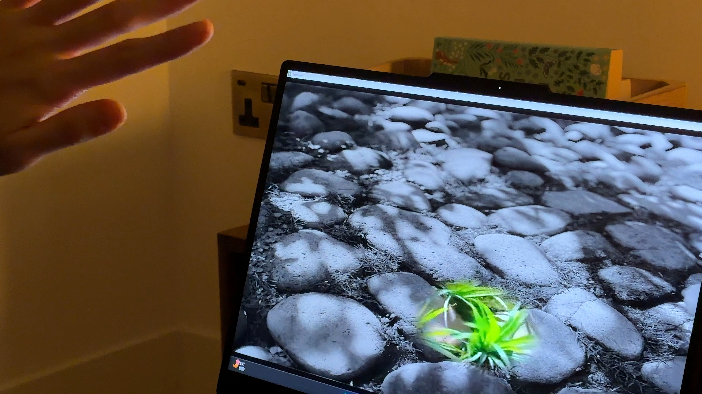
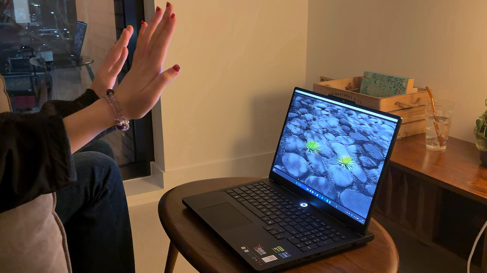
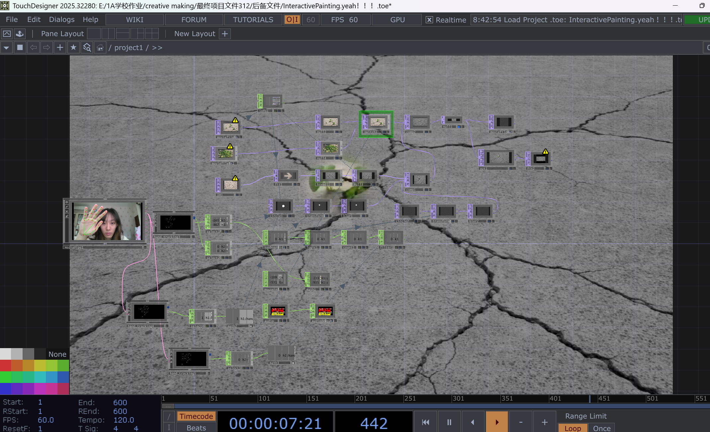

# Sprint 2: Interactive Prototype - Where Light Touches

# 1. Project Overview & Team Roles

| Member | Role & Contribution |
|------|------|
| Ruoxin Zhou | TouchDesigner node architecture, MediaPipe integration, coordinate mapping, multi-user logic gating , and signal smoothing. |
| Ganlin Feng | Concept development, gesture interaction design, ecological narrative design, debugging and testing the final project. |
| Xin bian | Designed the visual visual experience and rendering logic optimization, camera setup, lighting debugging, and user testing.|

**Prompt Chosen:** Ecosystems and Interdependence 
  
---

## 2. Project Motivation & Core Research Question

### 2.1 Core Research Question
How can we design an interactive system that decenters human control, using bodily presence instead to reveal ecological fragility and distributed agency?

Traditional interactive arts often empower the user (e.g., I wave my hand, the screen paints a line). This project actively subverts that expectation. In **Where Light Touches**, the viewer does not "control" the digital plants. Instead, their physical presence alters the environmental conditions (light intensity/energy) that the ecosystem depends on.

### 2.2 Design Goals
We aimed to build a responsive system that demonstrates:
* **Distributed Agency:** The system has its own life cycle; human interaction only modifies its trajectory.
* **Accumulated Consequences:** Brief interactions cause ripples; sustained over-intervention causes systemic decay.
* **Imperfect Recovery:** Once the ecosystem is stressed, it does not easily bounce back, leaving digital footprints.

---

## 3. System Architecture & Data Flow

To transition from a rigid prototype to an organic, body-driven ecosystem, the TouchDesigner network was structured into three distinct data pipelines:

### 3.1 Signal Processing & State Evaluation (CHOPs)
I utilised the MediaPipe plugin (`hand_tracking3`) to specifically isolate semantic human presence, splitting the data into spatial and boolean logic.

    MediaPipe Hand Tracking (Max Hands = 2)
            ↓
    Data Extraction (Select CHOPs)
    - select1 / select2: Extracts Spatial X/Y coordinates for Hand 1 & Hand 2.
    - select4 / select3: Extracts Boolean States (`h1:hand_active`, `h2:hand_active`).
            ↓
    Temporal Smoothing (Logic CHOP)
    - `logic1` (Off Delay = 1.0s): Buffers the jittery signal from the second hand.
            ↓
    State Evaluation (Switch TOP)
    - Code: `1 if op('logic1')[0] > 0.5 else 0`
    - Function: Swaps the underlying ecological video between "Growth" and "Decay" based on multi-user intervention.

### 3.2 Spatial Mapping (Python & Transform TOPs)
To ensure the user's physical movement correlates organically with this digital ecosystem, mathematical normalisation was required.

    Normalised CHOP Data (0.0 to 1.0)
            ↓
    Python Expressions in transform1 & transform2
    - X-Axis (Centering): `(op('select1')['x'] - 0.5)`
    - Y-Axis (Inversion & Centering): `(0.5 - op('select1')['y'])`
    - Conditional Visibility: `... if op('select4')['h1:hand_active'] else 100`
            ↓
    Output: Light sources accurately track hands and auto-hide when absent.

### 3.3 Visual Compositing & Ecological Feedback (TOPs)
This is the core of the visual interaction. Instead of just placing video over the background, the interactive light acts as a dynamic alpha mask.

    circle1 & circle2 (Light Sources) → blur1 & blur2
            ↓
    add1 (Combines both light sources)
            ↓
    feedback1 & level1 (Opacity < 1.0)
    - Creates a lingering, organic trail of "nourishment."
            ↓
    matte1 (Alpha Masking)
    - Uses the feedback trails to mask the `switch1` video output. 
    - The digital flora ONLY appears where the hand's light has touched.
            ↓
    composite1 (Over mode)
    - Overlays the thriving/decaying flora onto the static concrete background (`moviefilein3`).

---

## 4. Interaction Design & Ecological Mapping

We mapped specific physical gestures not to direct commands, but to **environmental stressors**. 

| Human Gesture (Input) | System Interpretation | Ecological Response (Output) |
| :--- | :--- | :--- |
| **Zero Hands Present** | Baseline Environment | Neutral state / Subdued existence. |
| **One Hand Active** | Nurturing Light / Balanced Energy | **Thriving:** Digital plants grow along the hand's trajectory via `Feedback TOP` loops. |
| **Two Hands Active** | Over-intervention / Ecological Stress | **Decay Sequence Triggered:** The system abruptly shifts (via `Switch TOP`); colors fade, vitality drops. |
| **Hands Retreat (Post-Stress)** | Environmental Recovery | **Scarred Recovery:** The ecosystem attempts to rebuild, but structural integrity is permanently altered. |

---

## 5. Technical Challenges & Evidence of Learning

Moving from a conceptual framework to a working prototype presented significant technical hurdles.

### 5.1 From Rigid Inputs to Organic Feedback Loops
* **Challenge:** Our initial prototype used keyboard presses to change the light's size and the mouse to move it. This felt mechanical and completely contradicted our concept.
* **Solution:** I integrated MediaPipe, extracting spatial landmarks to replace the mouse. By chaining a `Feedback TOP` into a `Matte TOP`, the hand now leaves a lingering trail of nourishment that acts as an alpha mask, slowly revealing the underlying video of growing grass. This creates a true sense of organic accumulation rather than just moving a flat graphic.

### 5.2 The Coordinate Bug & Y-Axis Inversion
* **Challenge:** MediaPipe outputs `0` when a hand disappears. This caused our interaction source to snap to the bottom-left corner `(-0.5, -0.5)` of the screen when users left, leaving a permanent light in the Feedback loop. Furthermore, the camera's Y-axis was physically inverted compared to the digital space.
* **Solution:** I implemented advanced conditional Python expressions. By coding `(0.5 - op('select1')['y'])`, I simultaneously centred the coordinates and fixed the inversion. Adding the conditional `if ... else 100` gracefully banished the interactive light source far outside the render space when no human is present, curing the light artefacts.

---

## 6. Documentation & Media Assets

* **Image 1:** State 1 - Nourishing (Single User interaction)

* **Image 2:** State 2 - Ecological Stress (Multi-User Interference)

* **Image 3:** TouchDesigner Setup

* **Demo Video:** 

assets/19d29c1d-8f13-4911-b73e-886eba97ecaa.mp4

