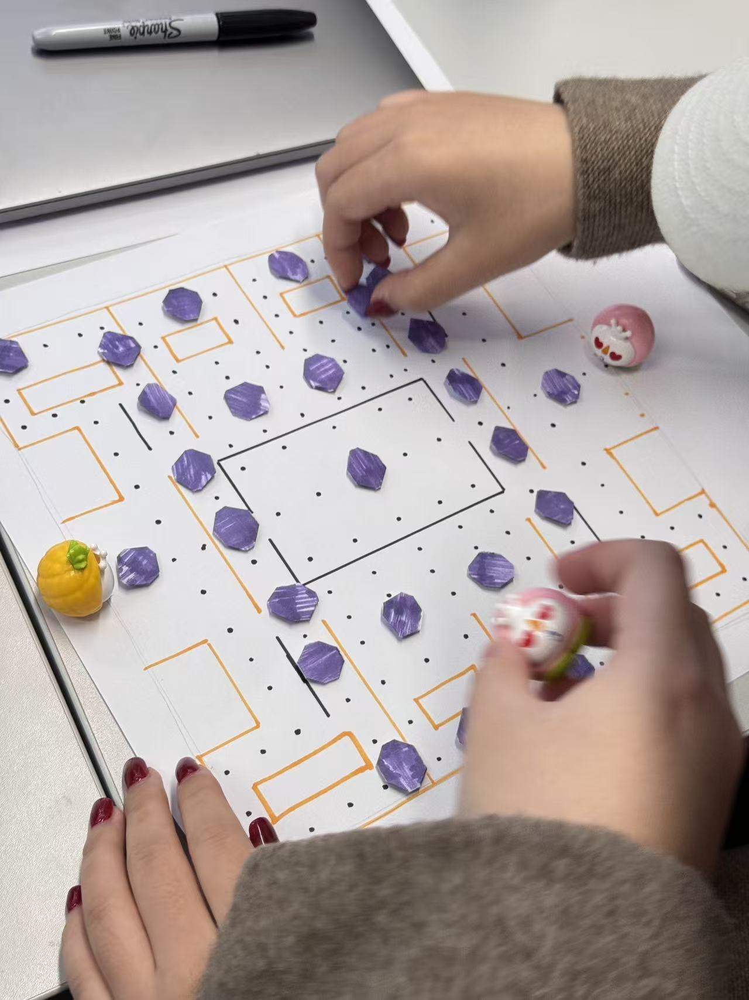
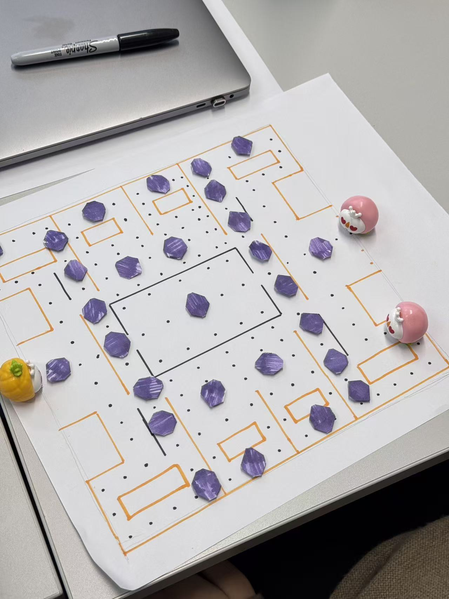
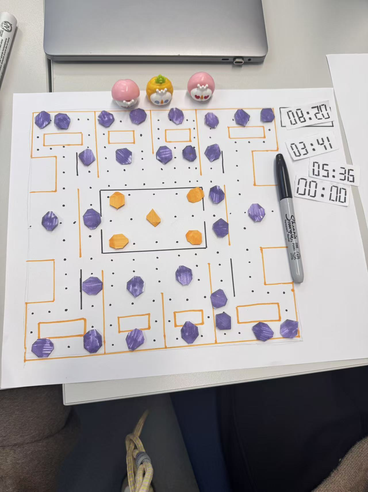
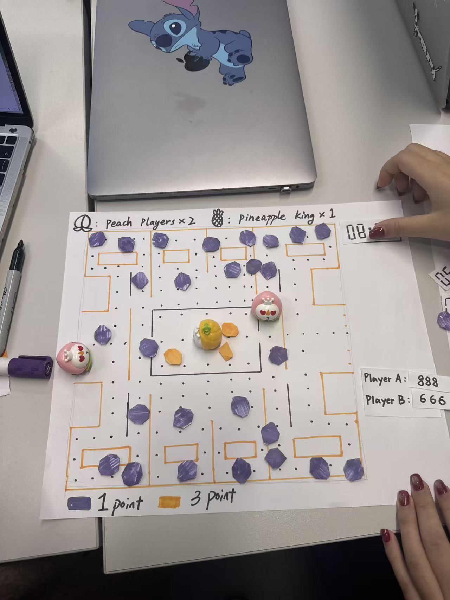
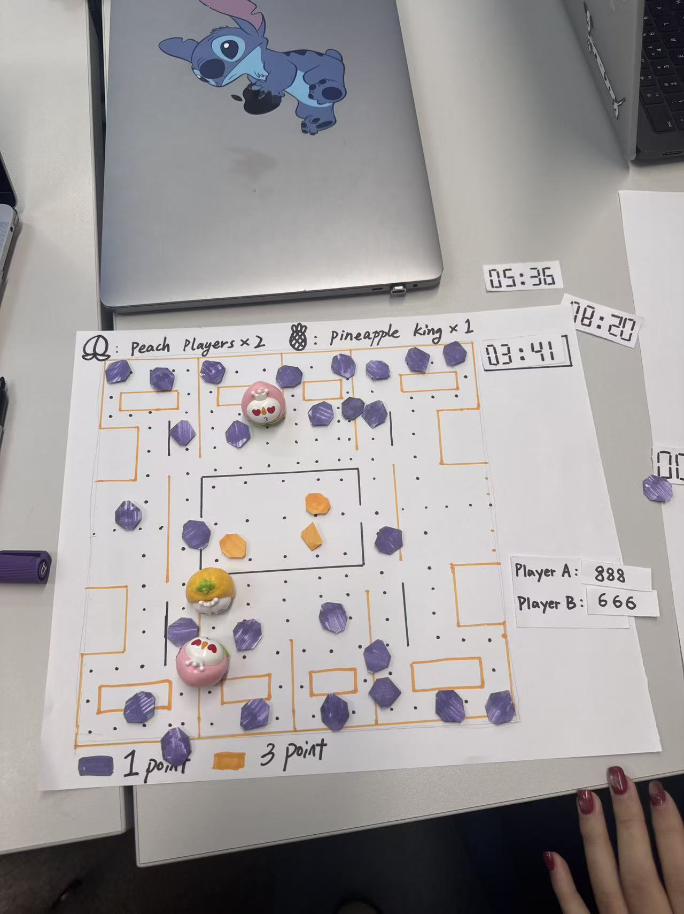

## Week #1

### Reading
💥 Reading Response  
After reading this week’s texts, I realized that play is much more than just "having fun" or passing time. Sicart argues that play is a way of "being in the world" that is creative, often acting like a "carnival" that turns normal life upside down. This idea connects really well to Marcotte’s article on "queering" controllers. She suggests that standard controllers (like the Xbox gamepad) force us into a "flow" where we stop thinking, so we need to change the physical controls, like holding hands or touching a plant—to disrupt this comfort and make players reflect. Bogost adds another layer by explaining "proceduralism," where the rules and mechanics themselves create the meaning of the art, rather than just the story or graphics.  
This week's reading made me think about the tension between "flow" and "meaning". Both Sicart and Marcotte seem to value experiences that are disruptive, dangerous, or even no fun because they force us to pay attention. But where is the line between a meaningful disruption and just bad design? If a controller is too hard to use, or if a game is too frustrating because it wants to be art, will players just quit before they understand the message? I wonder if we can have both deep reflection and the satisfying feeling of flow at the same time.  

### Fabricating & Building
💥 Game Rules: Competitive Pac-Man  
Our game is a modification of the original Pac-Man. While the original game focuses on single-player survival (avoiding ghosts) and clearing the map, we shifted the core mechanics to a two-player competitive time-attack mode. This introduces a risk-reward strategy and direct competition.  

Roles: The game involves 3 participants: 2 Players (playing as "Peaches") and 1 System Operator (playing as the "Pineapple Demon King," responsible for moving tokens, enforcing rules, keeping time, and tracking scores).  
Map & Zones: We use the standard Pac-Man maze. The center is designated as the "High-Risk Zone," while the rest is the "Safe Zone."  

Scoring:  
Safe Zone: Purple coins are worth 1 point each.  
High-Risk Zone: Yellow coins are worth 3 points each.  
Penalties: The game has a fixed time limit. The Pineapple Demon King patrols the High-Risk Zone. If a player is touched by the Demon King in this zone, they suffer a 10-second respawn penalty and lose 10 points.  
Victory: When time expires, the player with the higher score wins.  
Setup Process：  

