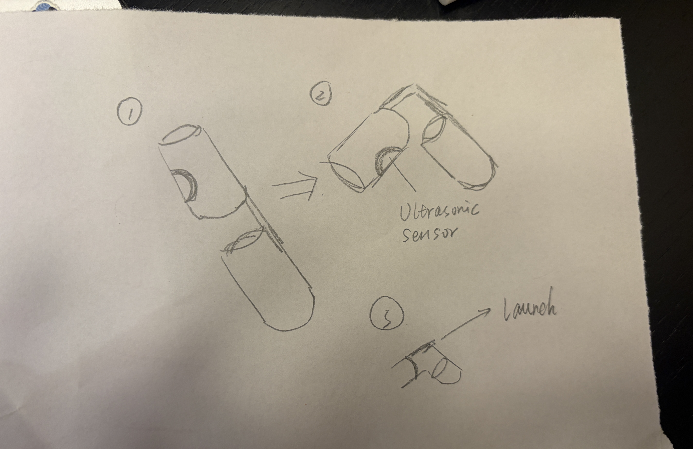
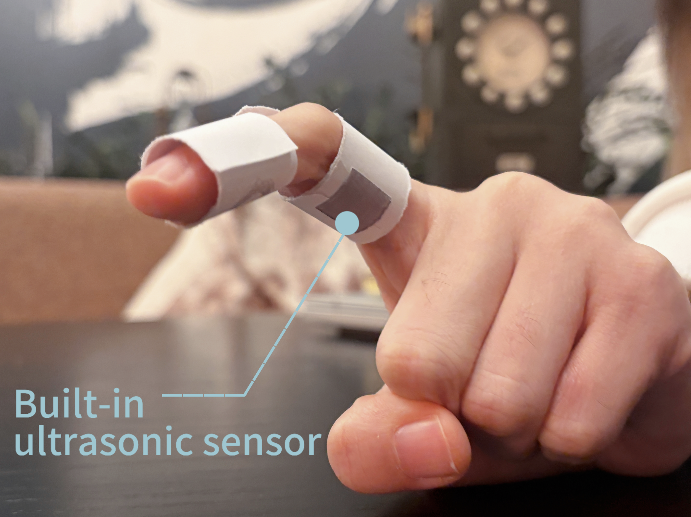
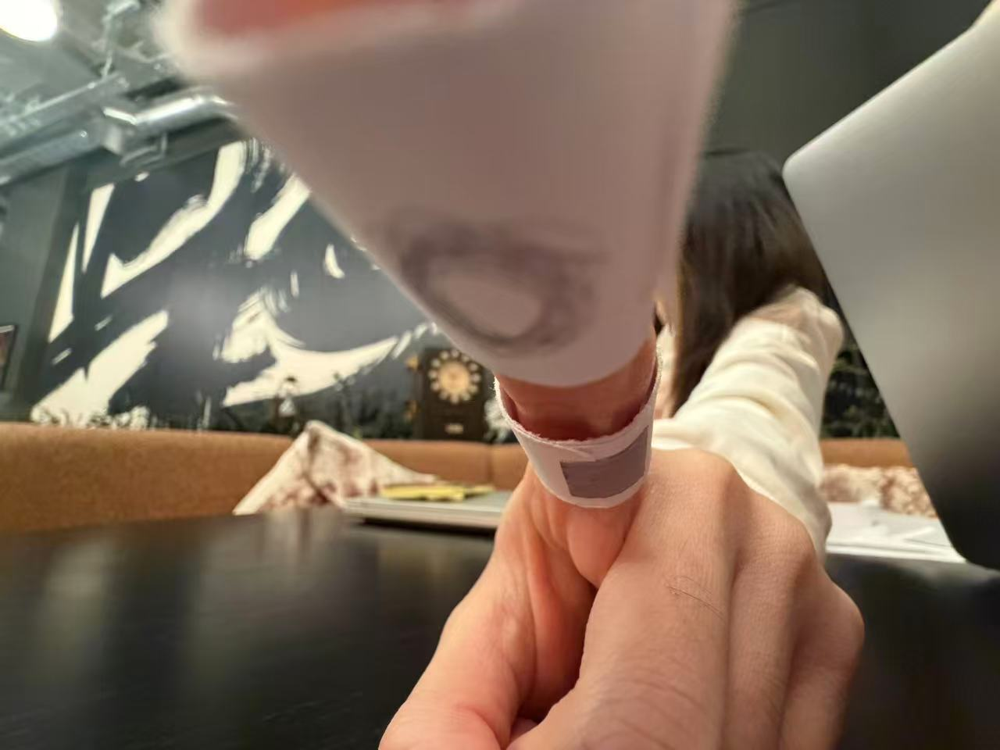
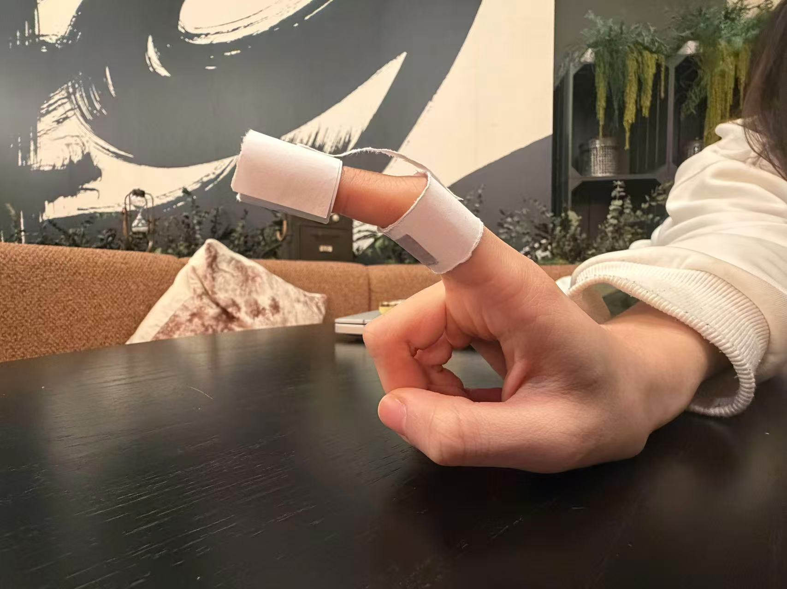
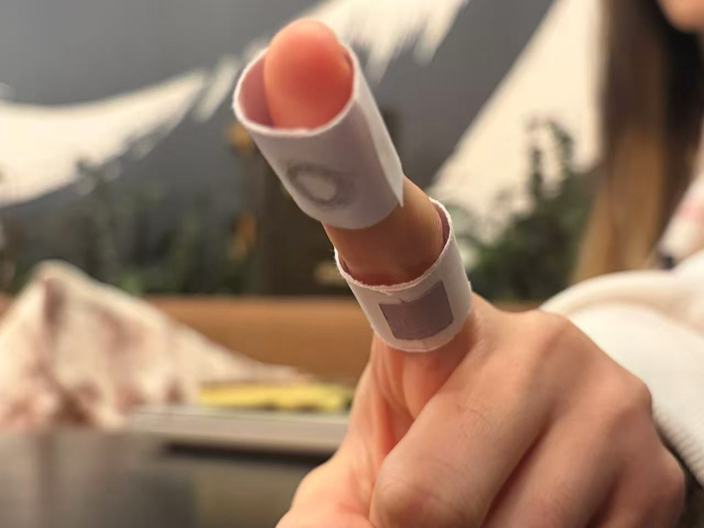

## Week #2

### Reading
💥 This week's reading discusses games as art by defining the medium, unpacking the popular opinion of games as "low culture," and tracing the influence of Fluxus art. Pearce also explores game modding, player communities, and the various ways games are exhibited. Her reflection covers a wide breadth of factors, addressing art history, gender representation, and material influences in the cultural development of games.  
From what I could gather, games carry intrinsic roots in the arts world but are largely not considered part of it. This exclusion appears to be due to the community's peer-to-peer development style (contrary to the historical teacher-to-student model in the arts), the ease of reproduction (which implies a different monetary value system), and the limiting nature of exhibition environments. Consequently, games as an artistic expression often manifest best in "anti-gallery" spaces, causing traditional art consumers to overlook the genre.  

### Fabricating & Building
💥 1.Identify what the controller privileges  
What kind of body does a standard controller assume  
A standard shooting controller assumes the player can perform fast, repeated, low effort button presses. It relies on quick fingertip actions and does not require clear joint movement or bodily preparation.  

What actions does it make easy  
It makes rapid shooting, continuous clicking, and reflex based actions very easy. It requires little bodily awareness or movement control.  

What actions does it make difficult or invisible  
It encourages long periods of finger movement, which can lead to finger fatigue and muscle soreness.  

What bodily capacity or experience do you want to centre instead  
We want to centre continuous finger joint bending as the core action. Shooting is changed from a single instant click into a bodily action that must be completed, increasing player immersion.  
 

2.Sketch the controller as an actor  
Where the body makes contact 
The controller is attached to the player’s index finger. It touches the first and third finger joints and follows the bending motion through a paper structure.

What kinds of pressure, motion, or attention are required  
The player must consciously bend the index finger and control the range and rhythm of the movement instead of clicking quickly. Attention shifts from speed to awareness of the bodily action.  

What feedback the controller gives back  
Tactile feedback comes from the paper pieces moving closer during bending. Visual feedback comes from whether shooting happens in the game. The paper structure also creates slight resistance on the finger, indicating how complete the action is.  

What does this controller ask the player to do  
It asks the player to complete a clear finger bending action rather than relying on automatic pressing.  
assets/050c555a-781e-4040-94de-4acac71bc9fd.mp4

assets/aa3a9098-e6a7-43ee-8b73-bb4e7d8a7892.mp4

3.Build a rough paper version of your controller. Add a photo to your notebook  
The controller is made from paper and tape and attached to the index finger. One paper piece is placed on the first finger segment and another on the third segment to sense finger bending.  
  
4.Add interaction rules  
What counts as an input  
When the first and third finger segments bend until their distance is smaller than a set threshold, the system recognises this as one shooting input.  

What happens if the player moves too fast or too slow  
Moving too fast may cause false triggers or unstable shooting. Slow and steady bending is easier to recognise accurately.  

What does the controller resist, ignore, or amplify  
The controller ignores incomplete or very small bending movements. It amplifies clear and complete finger bends. It resists fast, unconscious clicking actions.  

5.Give your controller to another group without instructions  
What do they try first  
They usually try to click their finger quickly like a button.  

What confuses them  
Shooting does not happen with small or fast movements.  

What feels intuitive or awkward  
After understanding that a full finger bend is needed, shooting becomes more predictable. Compared to a traditional button, it feels awkward at first.  

assets/74a6a7f1-a9d0-45d3-a610-0f43fa5de289.mp4

How does their body change  
Finger movements become slower. Players start paying attention to finger tension and posture.    

### Reflecting, inspiration, and project ideas
💥 Written reflection   
What affect did the controller produce before the rules were understood  
Before the rules were understood, the controller mainly produced hesitation and uncertainty. Shooting was no longer automatic and became a bodily action that required preparation and completion.  
