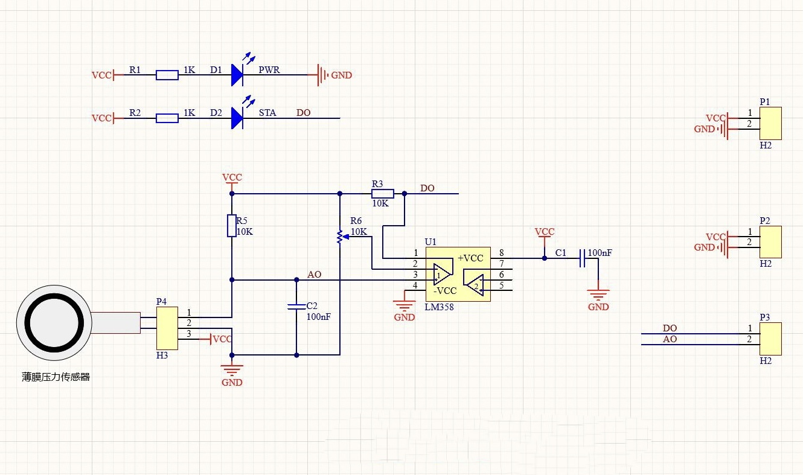
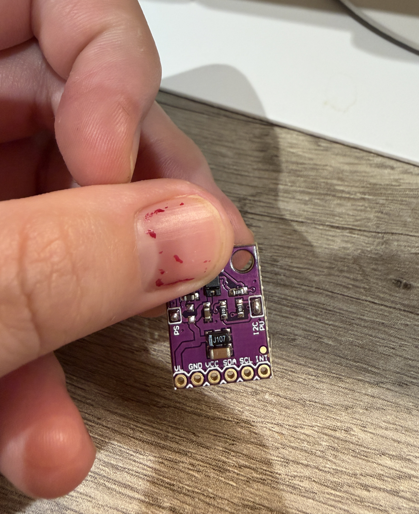
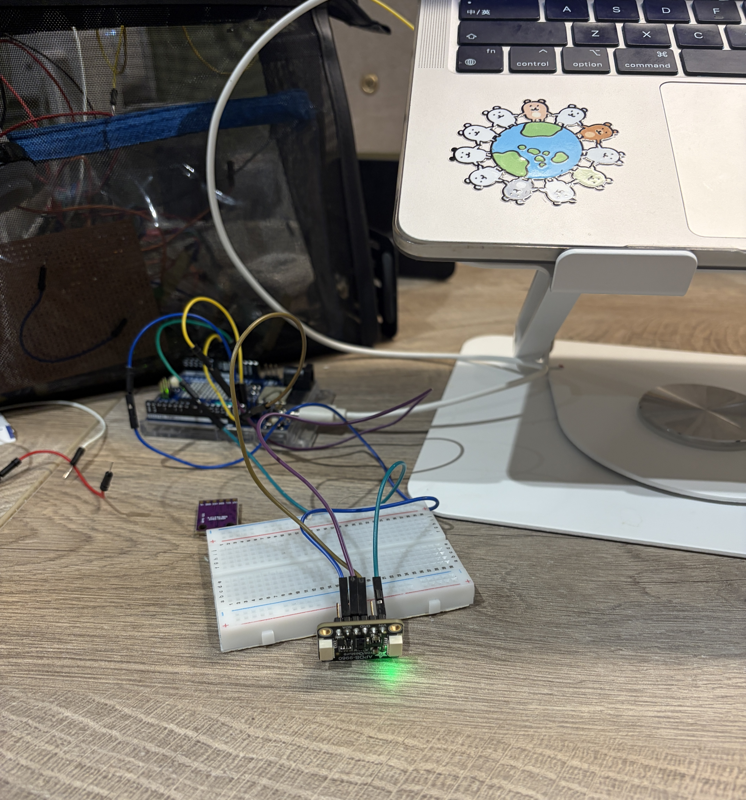
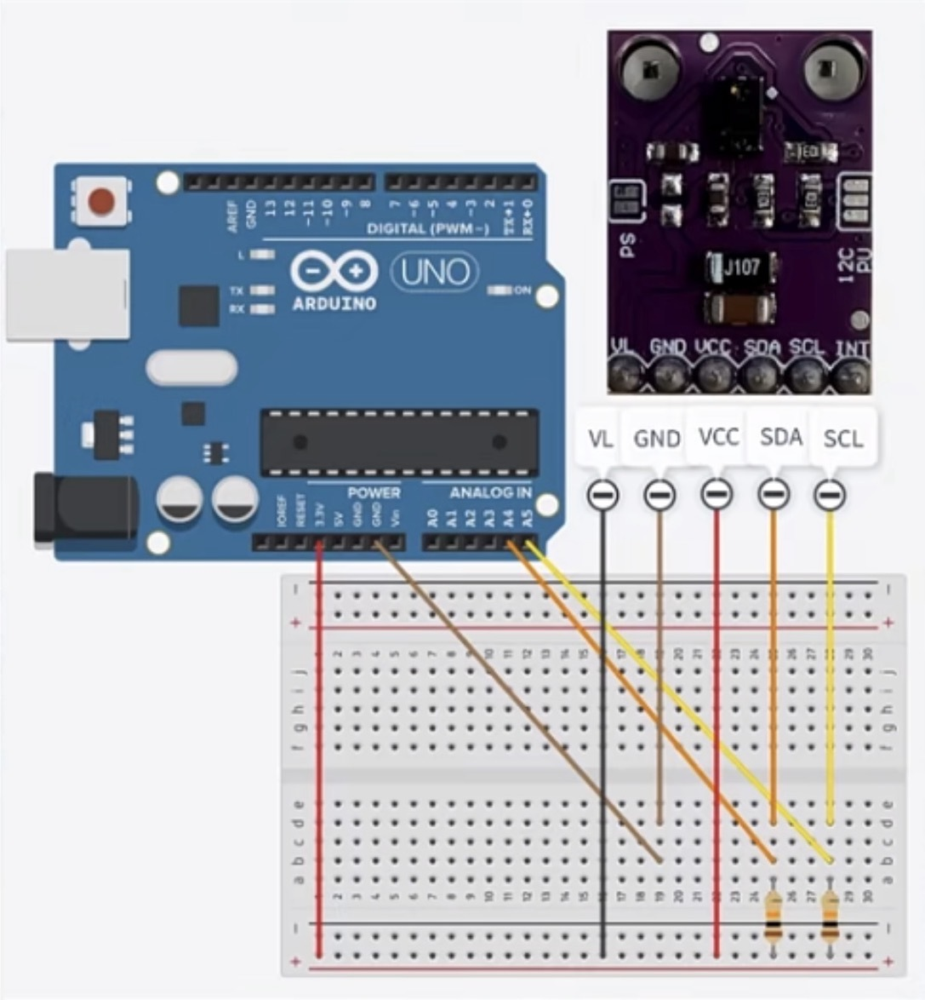

## Week #4

## Hardware Task: Sensor Selection & Arduino Firmware

### 1. Concept: Translating Physical Gestures
For our Sprint 1 prototype, we decided to explore non-contact interaction to control the core mechanic of our game: the horizontal movement of the Tetris blocks. 

To keep the interaction intuitive, we aimed to map fundamental physical actions to the digital space:
* **Swipe Left** → Tetris block moves left
* **Swipe Right** → Tetris block moves right

### 2. Hardware Research & Selection Process

**Step 1: Pressure Sensor**

###### Figure 1: Pressure sensor reference circuit explored during the initial research phase.

Initially, we intended to use a pressure sensor. While exploring standard module circuits, we realized they typically provide two outputs: AO (Analog) and DO (Digital). 
* The **Analog Output (AO)** provides continuous, variable data based on the applied force.
* The **Digital Output (DO)** acts as a binary trigger (on/off) once the pressure exceeds a specific threshold.

For our Tetris controller, physical pressure felt analogous to a hard key press, making it potentially suitable for actions like "Hard Drop" or "Rotate". Conversely, gesture control maps more naturally to spatial movement (left/right positioning). Since we couldn’t acquire a pressure sensor in time, we pivoted entirely to gesture control for this iteration.

**Step 2: PAJ7620 Gesture Sensor**

###### Figure2: DollaTek PAJ7620U2 Gesture Recognition Sensor Module

Next, we investigated the PAJ7620 gesture sensor. It supports comprehensive multi-gesture recognition. However, after reviewing its documentation, we concluded that its setup and library dependencies were unnecessarily complex for our current MVP (Minimum Viable Product) stage.

**Step 3: APDS9960 Gesture Sensor**

###### Figure 3: APDS9960 sensor module tested；
###### Figure 4: The wiring diagram we used as a reference was drawn from the previous version of APDS9960；

We then shifted our attention to the APDS9960. It offers reliable gesture recognition supported by highly accessible libraries. After comparing various modules, we selected a specific APDS9960 (3.3V/5V) breakout board. Its wiring is straightforward, and the power supply is stable.

### 3. Arduino Firmware Design & Testing

assets/58b23f4e-4d29-41c7-97ec-8cb59f4160ea.mp4

###### Video 1: Verification of the APDS9960 functioning flawlessly within the standalone Arduino Serial Monitor.

We wired the APDS9960 to an **Arduino UNO R4 WiFi** via I2C communication (SDA/SCL pins). 

Writing the firmware required careful consideration. Instead of sending complex data structures, we designed the firmware to be extremely lightweight. Using the sensor's gesture engine, the Arduino reads spatial movement. If a left or right swipe is detected, the microcontroller prints a simple, single-character string (`"L"` or `"R"`) to the Serial Monitor.

As shown in the video above, during isolated testing, the Arduino Serial Monitor successfully displayed the correct directional characters when we waved our hands above the sensor. This confirmed that our hardware layer, wiring, and firmware logic were fully operational.

