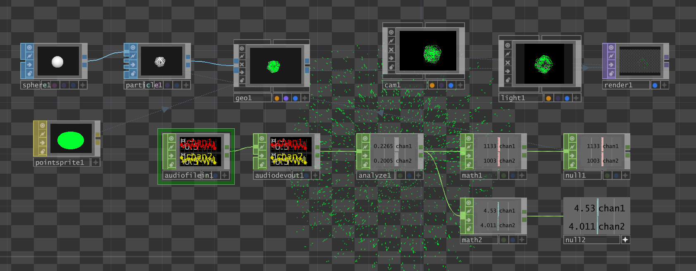
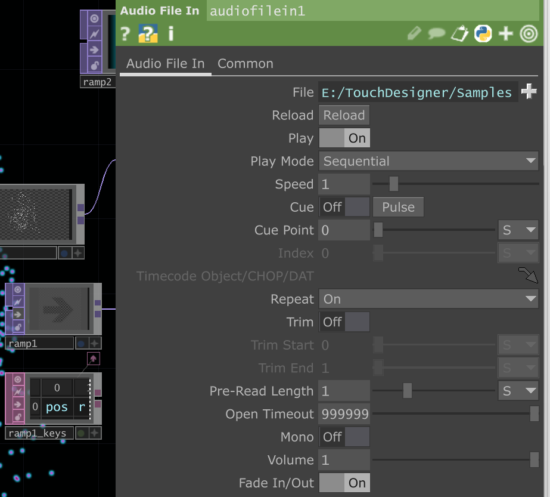
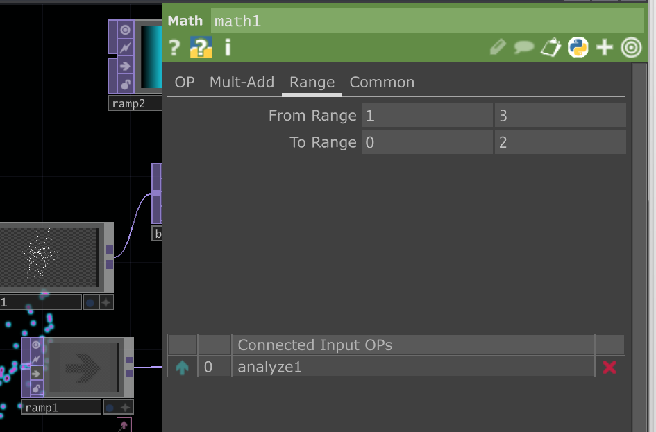

## Week #7

### Reading
***Text: Vaughan-Lee, E. (2021). Letter from the Editor. Emergence Magazine, Vol. 3.***  
The power of storytelling lies not merely in narration, but in awakening the often-overlooked act of listening.  
***Text: Dunne & Raby. "A Methodological Playground: Fictional Worlds and Thought Experiments" Ch. 5***  
After reading this article, my strongest takeaway is that design isn't just about creating things that work today—it can also envision the future. I used to think design was solely about making products and crafting aesthetics, focusing on practicality and feasibility, not wild flights of fancy. But design can actually transcend the “present” to contemplate “possible futures,” using thought experiments to reflect on current issues like our dependence on technology, the relationship between the environment and humanity, and other such questions. Design isn't just about getting your hands dirty—it's about engaging your mind. Don't worry if your ideas seem impractical; they might just help us see current problems more clearly and uncover new solutions.  

### Coding
For the tutorial and software practice this week, I decided to dive deep into TouchDesigner. I wanted to see if I could make audio data drive a visual system in real-time.
Rhythmic Particle Generator
Here is a screen recording of my project in action:
assets/d7d7fe6f-273a-4412-98ef-af16ab2fff5e.mp4

assets/62df8716-f0ea-484c-9a7e-01564b22d0ed.mp4

I set up an audio-reactive particle system. The core idea was to take an audio feed, analyze the frequencies and volume, and use that math to dictate how the particles spawn, move, and dissipate.  

To make sure the system was actually dynamic, I spent a lot of time testing it with different audio tracks. As you can see in the video, I switch between a few songs to see how it performs. Bass-heavy tracks create a completely different clustered burst compared to tracks with higher, softer frequencies.  

I also spent a good chunk of time fine-tuning the math. I had to adjust the range values in the Math nodes quite a bit. If the range is too wide, the particles just explode chaotically off-screen; if it's too tight, it barely looks like it's reacting.  

  
### Reflecting, inspiration, and project ideas
Next, I hope to explore more interactive features, such as connecting real-time microphone input or adding camera input, and using gestures to push these audio reaction particles across the screen.  
