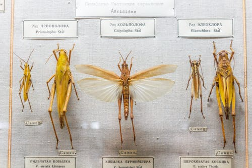

# Week 8: Sprint 2 Concept Ideation & Theoretical Framework

## 1. Prompt Selection
This week, our team finalized the core direction of the project. In response to the requirements outlined in the brief, we selected the theme of **Ecosystems and Interdependence** and are committed to exploring **More-Than-Human Design** within interactive systems.

## 2. Theoretical Research & Concept Development 
To give the project a deeper critical dimension, we delved into theories of biological evolution and environmental interaction. We drew inspiration from two opposing yet complementary ecological perspectives:
* **Charles Darwin (Theory of Natural Selection):** Organisms are passively shaped by their environment. Climate and environmental harshness—such as strong winds, drought—can irreversibly shape or eliminate life.

* **Henri Bergson (Theory of Creative Evolution):** The essence of life is not merely passive adaptation to the environment, but an inner vital impulse (Élan vital) that continuously generates dynamic responses through friction with the external world.

**Applying Theory to the Project:**
Based on these theories, we developed the concept for this project. We decided that: **In this interactive system, humans will no longer be the “Creator” wielding absolute power, but will instead become a massive “Environmental Variable.” **When a human arm enters the digital space, it serves as a metaphor for sunlight, climate, or human interference in the urbanization process. Digital plants will respond to these “lighting conditions” with organic growth, as described by Bergson; however, if the intervention is excessive (such as multiple hands appearing simultaneously), the system will trigger a survival pressure mechanism akin to “natural selection,” leading to withering.
